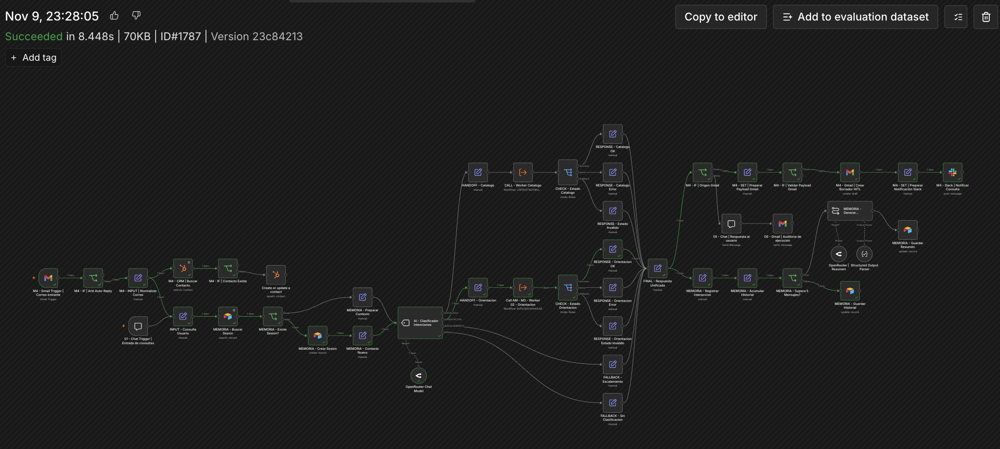
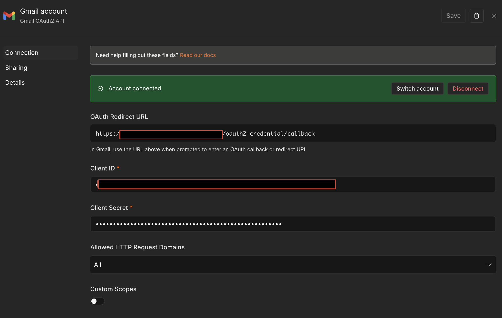
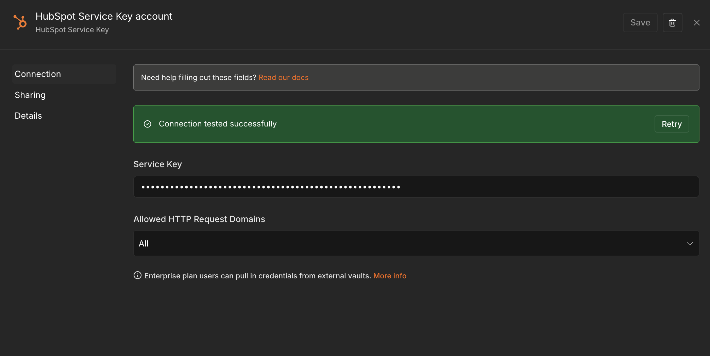
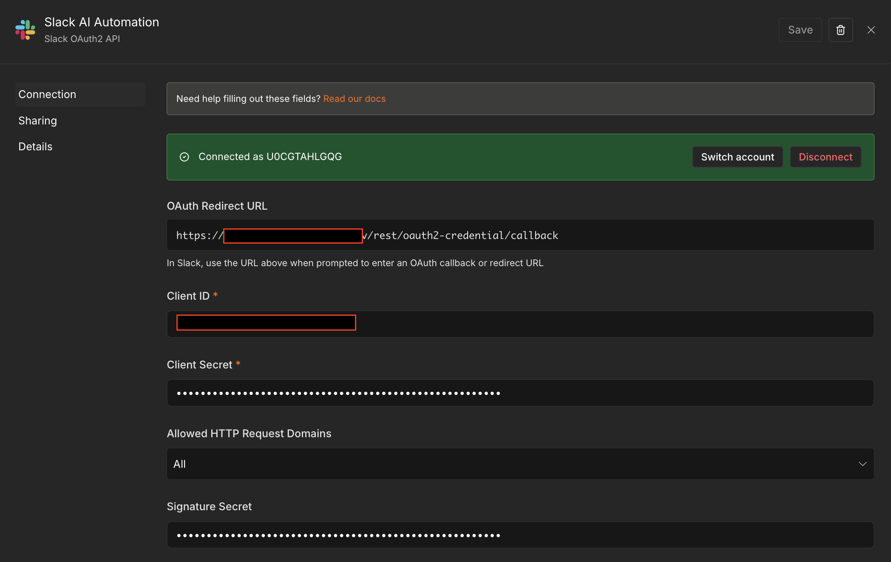
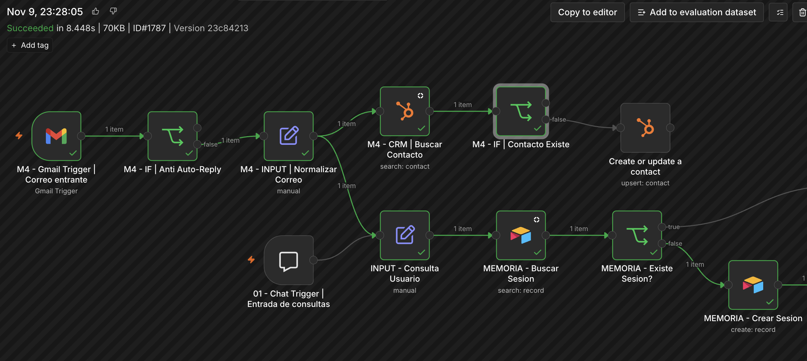
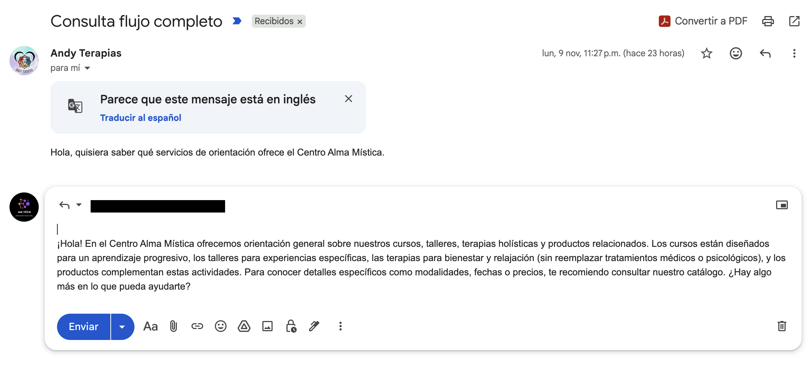
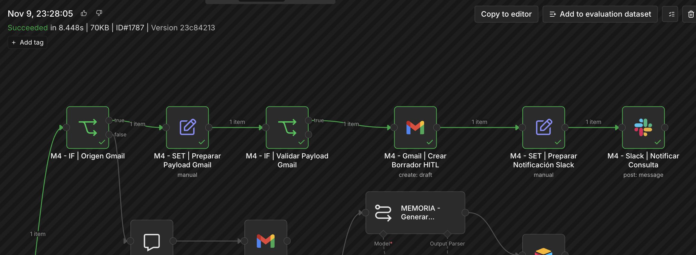
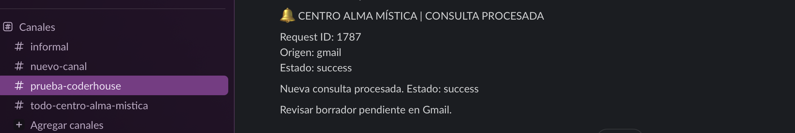

# Checkpoint 4 — Integraciones Avanzadas e Interconexión de Sistemas

**Proyecto:** Centro Alma Mística  
**Curso:** AI Automation Avanzado — Coderhouse  
**Plataforma:** n8n  
**Modalidad:** Proyecto integrador incremental — Módulo 4

---

## Índice

1. [Descripción general](#1-descripción-general)
2. [Arquitectura e integraciones](#2-arquitectura-e-integraciones)
3. [Controles preventivos y Human-in-the-Loop](#3-controles-preventivos-y-human-in-the-loop)
4. [Pruebas funcionales y evidencias](#4-pruebas-funcionales-y-evidencias)
5. [Instalación y consideraciones finales](#5-instalación-y-consideraciones-finales)

---

## 1. Descripción general

Este checkpoint amplía la arquitectura multi-agente desarrollada en los módulos anteriores, incorporando integraciones reales con **HubSpot, Gmail y Slack** mediante n8n.

Se conserva el Manager del Módulo 3 como base de la orquestación, junto con los Workers especializados de Catálogo y Orientación y la memoria persistente en Airtable.

La ampliación permite recibir consultas por Gmail, verificar o registrar contactos en HubSpot, procesar solicitudes mediante el sistema multi-agente, generar borradores sujetos a revisión humana y notificar al equipo mediante Slack.

También se incorporan controles preventivos no-code para filtrar respuestas automáticas, evitar contactos duplicados y validar los datos antes de ejecutar operaciones externas.

### Arquitectura general — Manager M4



*Figura 1. Arquitectura completa del Manager M4 durante la ejecución exitosa #1787. Se observan las integraciones externas, la orquestación multi-agente y la persistencia en Airtable.*

### Estructura del repositorio

```text
checkpoint-4-alma-mistica/
│
├── README.md
├── AM - M4 - Manager.json
│
├── workers/
│   ├── AM - M3 - Worker 01 - Catalogo.json
│   └── AM - M3 - Worker 02 - Orientacion.json
│
└── evidencias/
    ├── 01-evidencia-arquitectura-manager.png
    ├── 02-evidencia-control-hubspot.png
    ├── 03-evidencia-gmail-slack.png
    ├── 04-evidencia-borrador-gmail.png
    ├── 05-evidencia-notificacion-slack.png
    ├── 06-credencial-gmail.png
    ├── 07-credencial-hubspot.png
    └── 08-credencial-slack.png
```

---

## 2. Arquitectura e integraciones

El sistema mantiene una arquitectura modular compuesta por un workflow Manager y dos Workers especializados, reutilizados del Módulo 3.

El Manager centraliza la recepción de consultas, recuperación de memoria en Airtable, clasificación de intenciones, delegación a Workers y generación de respuestas.

### 2.1. Integraciones externas

| Herramienta | Función | Autenticación |
|---|---|---|
| **HubSpot CRM** | Buscar contactos por correo y registrar aquellos que no existen. | Service Key |
| **Gmail** | Recibir consultas, filtrar respuestas automáticas y crear borradores. | OAuth2 |
| **Slack** | Notificar al equipo sobre borradores pendientes de revisión. | OAuth2 |

### 2.2. Flujo de procesamiento

**Entrada Gmail**

1. Gmail Trigger recibe el mensaje y el IF preventivo verifica si corresponde a una respuesta automática.
2. Se normalizan los datos y se consulta HubSpot para identificar contactos existentes.
3. El Manager recupera el contexto de Airtable, clasifica la intención y delega al Worker correspondiente.
4. Se unifica la respuesta y se valida el payload destinado a Gmail.
5. Gmail crea un borrador sin enviarlo automáticamente.
6. Slack notifica al equipo que existe una respuesta pendiente de revisión.

La consulta al CRM y el procesamiento de la solicitud parten de la entrada normalizada y constituyen ramas diferenciadas de la orquestación.

**Entrada Chat**

La entrada original por Chat Trigger permanece operativa. Las consultas se procesan mediante el Manager y los Workers, entregando la respuesta directamente en el chat, sin activar Gmail Draft ni Slack.

### 2.3. Permisos, autenticación y decisión técnica sobre HubSpot

Las conexiones con Gmail y Slack se implementaron mediante OAuth2, utilizando credenciales autorizadas desde n8n.

Para HubSpot se evaluó inicialmente una conexión OAuth2, conforme a lo solicitado en la consigna. Sin embargo, durante la configuración se identificó que el procedimiento de creación de aplicaciones OAuth2 en la plataforma actual de HubSpot utiliza una arquitectura basada en proyectos y herramientas de desarrollo como HubSpot CLI, lo que introducía una complejidad adicional respecto del alcance no-code de este checkpoint.

La documentación oficial de HubSpot distingue entre aplicaciones que requieren autorización OAuth2 e integraciones internas entre sistemas (*system-to-system*).

Para estas últimas, HubSpot incorporó las **Service Keys**, disponibles desde febrero de 2026, que permiten autenticar llamadas a su API sin implementar un flujo OAuth2.

Considerando que Centro Alma Mística utiliza una integración interna entre n8n y una única cuenta de HubSpot, sin distribución a terceros ni autorización de múltiples clientes, se optó por una Service Key como mecanismo adecuado para este escenario.

La credencial se configuró con los siguientes permisos:

- `crm.objects.contacts.read`: consulta y búsqueda de contactos.
- `crm.objects.contacts.write`: creación y actualización de contactos.

De esta manera, se aplica el principio de mínimo privilegio, restringiendo el acceso a las operaciones necesarias.

**Alcance respecto de la consigna:** la integración funcional con el CRM está implementada y probada, pero utiliza Service Key en lugar del OAuth2 solicitado para HubSpot. Esta diferencia se declara expresamente y no se presenta como cumplimiento literal de ese requisito.

**Referencias oficiales de HubSpot:**

- [Service Keys enter public beta for system-to-system integrations — 10 de febrero de 2026](https://developers.hubspot.com/changelog/service-keys)
- [Legacy Private App Creation Being Disabled — 27 de agosto de 2026](https://developers.hubspot.com/changelog/legacy-private-app-creation-sunset)
- [HubSpot Developer Platform — Projects y CLI](https://developers.hubspot.com/developer-platform-basics)

### 2.4. Evidencias de autenticación

Las siguientes capturas muestran las credenciales configuradas y sus respectivos estados de conexión. Los valores sensibles y los identificadores no necesarios fueron ocultados.

**Gmail — OAuth2**



**HubSpot — Service Key**



**Slack — OAuth2**



---

## 3. Controles preventivos y Human-in-the-Loop

Se implementaron cuatro controles preventivos mediante nodos nativos de n8n, ubicados antes de las operaciones externas correspondientes.

Su objetivo es reducir errores de procesamiento, prevenir duplicaciones y evitar acciones automáticas no autorizadas.

### 3.1. Filtro anti auto-reply — Gmail

El nodo `M4 - IF | Anti Auto-Reply`, ubicado inmediatamente después del Gmail Trigger, evalúa el remitente, asunto y etiquetas disponibles.

Identifica patrones asociados a respuestas automáticas, notificaciones de ausencia, mensajes de no respuesta y correos enviados desde la propia cuenta.

- **True:** se descarta el mensaje y se detiene esa ruta de procesamiento.
- **False:** el mensaje continúa hacia la normalización.

Este control reduce el riesgo de procesar correos automáticos y generar ciclos de respuesta.

### 3.2. Prevención de contactos duplicados — HubSpot

Antes de registrar un contacto, el workflow ejecuta `M4 - CRM | Buscar Contacto`, utilizando el correo electrónico como criterio de búsqueda.

El nodo `M4 - IF | Contacto Existe` determina la operación:

- **True:** el contacto existe y se omite la escritura.
- **False:** se ejecuta `Create or update a contact`.

Este mecanismo disminuye el riesgo de crear registros duplicados.



*Figura 2. Ejecución #1787: HubSpot identifica un contacto existente y el nodo de creación permanece sin ejecutarse.*

### 3.3. Human-in-the-Loop — Gmail Draft

Las respuestas generadas para consultas recibidas por Gmail no se envían automáticamente.

El nodo `M4 - Gmail | Crear Borrador HITL` utiliza la operación **Create Draft**, dejando la respuesta preparada para revisión humana.

Este diseño separa la generación automática del contenido de su envío efectivo.

La aprobación y el envío se realizan manualmente desde Gmail, fuera del workflow de n8n.



*Figura 3. Borrador generado a partir de la consulta procesada en la ejecución #1787. El mensaje permanece editable y pendiente de revisión humana.*

### 3.4. Preparación y validación del payload

Antes de crear el borrador, `M4 - SET | Preparar Payload Gmail` construye cuatro campos:

| Campo | Función |
|---|---|
| `to_email` | Destinatario |
| `subject` | Asunto |
| `body_text` | Respuesta generada |
| `thread_id` | Identificador del hilo |

Posteriormente, `M4 - IF | Validar Payload Gmail` comprueba el formato básico del correo electrónico y que los campos obligatorios no estén vacíos.

Solo los datos que superan estas comprobaciones llegan al nodo Gmail Draft.

La validación verifica estructura y presencia de datos, pero no garantiza por sí sola la validez real del destinatario ni del contenido generado.

### 3.5. Secuencia de salida Gmail → Slack



*Figura 4. Ejecución #1787: preparación y validación del payload, creación del borrador Gmail y publicación de la notificación Slack.*

La ubicación de Slack después de Gmail Draft permite notificar al equipo únicamente cuando la creación del borrador ha continuado exitosamente por esa ruta.

Los controles están implementados en el lienzo mediante nodos nativos de n8n, sin incorporar código personalizado.

---

## 4. Pruebas funcionales y evidencias

Se realizaron pruebas de integración sobre Gmail, HubSpot y Slack, además de pruebas de regresión para comprobar la continuidad del sistema multi-agente.

### 4.1. Integración completa desde Gmail

**Ejecución n8n #1787 — Succeeded**

Se verificó el siguiente recorrido:

1. Gmail recibió una consulta real.
2. El filtro anti auto-reply permitió continuar el mensaje.
3. HubSpot identificó un contacto existente.
4. El Manager recuperó o inicializó el contexto de sesión en Airtable.
5. La consulta fue clasificada como `ORIENTACION`.
6. El Worker Orientación generó la respuesta.
7. Gmail creó el borrador sin realizar el envío.
8. Slack publicó la notificación correspondiente.

La ejecución se completó exitosamente y permitió comprobar el funcionamiento conjunto de las tres integraciones.

### 4.2. Prevención de duplicados

Se comprobaron dos escenarios:

- **Contacto inexistente:** el sistema ejecutó la operación de creación en HubSpot.
- **Contacto existente:** el sistema identificó el registro y evitó una nueva escritura.

### 4.3. Resultado de la integración con Slack

La publicación real en Slack permite relacionar la ejecución de n8n con la notificación recibida por el equipo.



*Figura 5. Notificación publicada en `#prueba-coderhouse`, con Request ID 1787, origen Gmail y estado success.*

### 4.4. Regresión de la entrada Chat

Se verificó que las integraciones incorporadas en M4 no alteraran la ruta existente de Chat:

- El Manager continuó clasificando las intenciones.
- El Worker Catálogo recuperó información desde Google Sheets.
- Las respuestas se entregaron correctamente en el Chat.
- El IF de origen Gmail seleccionó la ruta correspondiente a Chat.
- No se generaron borradores ni notificaciones Slack desde esa entrada.

### 4.5. Persistencia y recuperación de contexto

Se realizaron consultas consecutivas dentro de una misma sesión.

Se comprobó que Airtable almacenara el historial y que, en una consulta posterior, el campo `historial_temporal` fuera recuperado y transmitido al Worker Catálogo mediante el contrato de entrada.

Esto permitió verificar la continuidad de la memoria persistente implementada en M3 y conservada en M4.

### 4.6. Trazabilidad mediante Request ID

El sistema utiliza `$execution.id` como identificador de solicitud, expuesto en el contrato como `request_id`.

Este identificador permite correlacionar la ejecución del Manager con sus resultados y las notificaciones externas.

En la prueba integral, el identificador **1787** permitió relacionar la ejecución exitosa de n8n con el mensaje publicado en Slack.

Este mecanismo constituye una base de trazabilidad operativa, aunque no sustituye una plataforma completa de observabilidad.

---

## 5. Instalación y consideraciones finales

### 5.1. Archivos exportados

El proyecto se distribuye mediante tres archivos JSON:

- [`AM - M4 - Manager.json`](<AM - M4 - Manager.json>) — Manager M4.
- [`AM - M3 - Worker 01 - Catalogo.json`](<workers/AM - M3 - Worker 01 - Catalogo.json>) — Worker Catálogo M3.
- [`AM - M3 - Worker 02 - Orientacion.json`](<workers/AM - M3 - Worker 02 - Orientacion.json>) — Worker Orientación M3.

Los Workers del Módulo 3 se reutilizan sin duplicarlos, manteniendo la evolución incremental de la arquitectura.

### 5.2. Dependencias

| Servicio | Función |
|---|---|
| n8n | Orquestación |
| OpenRouter | Modelos LLM |
| Airtable | Memoria persistente |
| Google Sheets | Catálogo comercial |
| Gmail | Recepción, borradores y auditoría |
| HubSpot | Gestión de contactos |
| Slack | Notificaciones |

### 5.3. Instrucciones de importación

1. Importar los dos Workers en n8n.
2. Importar el Manager M4.
3. Configurar las credenciales de los servicios externos.
4. Actualizar las referencias a los Workers en los nodos de llamada a subworkflows.
5. Configurar la base y tabla de Airtable, documento Google Sheets, cuenta Gmail, cuenta HubSpot y canal Slack.
6. Verificar los contratos de entrada y salida, especialmente `historial_temporal`.
7. Ejecutar pruebas controladas desde Chat y Gmail.
8. Activar el Manager solo después de validar toda la configuración.

**Importante:** los secretos de las credenciales —contraseñas, API keys y tokens— no están incluidos en los JSON. Sin embargo, los archivos sí conservan nombres e identificadores de credenciales, workflows y otros recursos, por lo que estas referencias pueden requerir actualización o reasociación al importar el proyecto en otra instancia de n8n.

El Gmail Trigger está configurado para consultar la casilla cada minuto. Se recomienda mantener el workflow inactivo hasta completar la instalación para evitar procesamiento involuntario de correos.

### 5.4. Seguridad y limitaciones

Los workflows exportados no contienen contraseñas, API keys ni tokens de acceso.

Sí incluyen referencias técnicas a recursos externos, identificadores de workflows y metadatos de configuración, por lo que deben revisarse antes de su distribución pública.

Esta implementación corresponde a un entorno educativo de laboratorio.

Para un despliegue productivo sería necesario complementar la solución con monitoreo, manejo de errores operativos, control de concurrencia, políticas de privacidad y mecanismos de recuperación ante fallos.

### 5.5. Conclusión

El Checkpoint 4 amplía el sistema multi-agente de Centro Alma Mística mediante integraciones reales con CRM, correo electrónico y mensajería de equipo.

Se conserva la arquitectura desarrollada en los módulos anteriores, incorporando controles preventivos, trazabilidad de ejecuciones y revisión humana antes del envío de respuestas por correo.

Las pruebas realizadas permiten validar el funcionamiento integrado de la solución dentro del alcance definido para el laboratorio.

